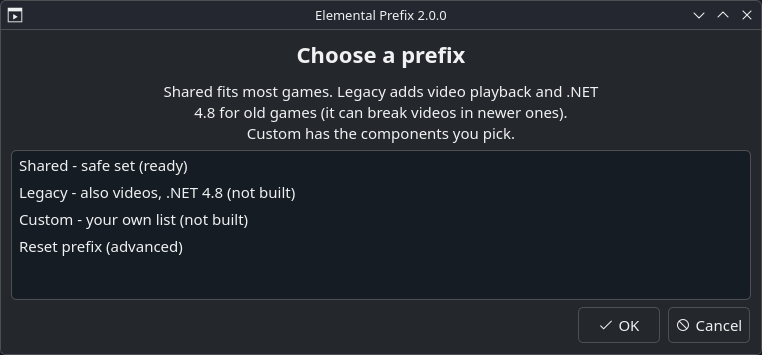
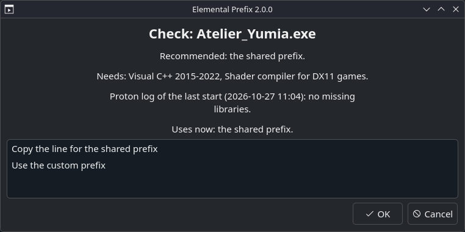
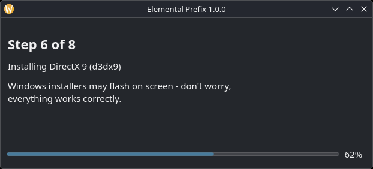
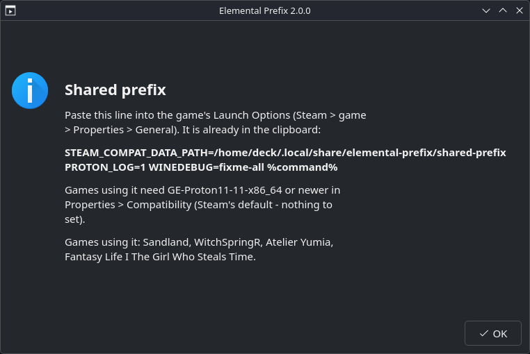

# Elemental Prefix

**English** | [Polski](README.pl.md)

Shared Proton prefixes with Visual C++, DirectX 9 and other common libraries for non-Steam games
and apps on the **Steam Deck** (SteamOS, Desktop Mode), and a check that tells what a game needs.

Old Windows games added to Steam as non-Steam games often fail to start because a fresh Proton
prefix has none of these libraries. Instead of installing them with Protontricks for every game,
Elemental Prefix prepares a prefix once. Any non-Steam game then uses it with one line in its
Launch Options:

```
STEAM_COMPAT_DATA_PATH=/home/deck/.local/share/elemental-prefix/shared-prefix PROTON_LOG=1 WINEDEBUG=fixme-all %command%
```

<table>
  <tr>
    <td></td>
    <td></td>
  </tr>
  <tr>
    <td></td>
    <td></td>
  </tr>
</table>

## Requirements

- Steam Deck in Desktop Mode.
- **Protontricks** from Discover. Elemental Prefix uses its winetricks.
- At least one Proton installed in Steam, or a custom one such as GE-Proton.

Nothing else to install, no `sudo`.

## Install

In Desktop Mode open Konsole and run:

```bash
curl -fsSL https://raw.githubusercontent.com/Koutasora/Elemental-Prefix/main/install.sh | bash
```

Run the same command again to update.

## Prefixes

| Prefix | Components | For |
|---|---|---|
| **Shared** | Visual C++ 2005–2022, DirectX 9, shader compiler, XAudio / XACT, PhysX, Windows fonts | most games |
| **Legacy** | Shared + video playback (`quartz`) + .NET Framework 4.8 | old games with black videos, .NET games |
| **Custom** | the ones you tick | games that need something else |

Libraries a game does not use do not get in its way, so one fixed set covers most games. Legacy
is separate because its video playback can break videos in games that played them fine, and
.NET 4.8 is large and takes about 10 minutes to install. Each prefix is built the first time you
choose it.

## Use

1. Open **Elemental Prefix** from the application menu and choose a prefix. The first time it asks
   for a Proton (Steam's default is preselected) and builds the prefix; this takes a few minutes.
2. The Launch Options line is copied to the clipboard. In Steam open the game's
   **Properties → General → Launch Options** and paste it.
3. In **Properties → Compatibility** use the same Proton as the other games on that prefix
   (with Steam's default there is nothing to set).

### Set up with Elemental Prefix

In Dolphin, right-click the game's `.exe` and choose **Set up with Elemental Prefix** (or right-click
Elemental Prefix in the application menu). The check only reads files:

- the libraries the game's programs import, and whether the game ships them itself;
- .NET programs, Bink videos, old video files, installers in the game folder;
- `dxgi.dll`, `d3d11.dll` and similar next to the `.exe` (ReShade and other mods): the line gets
  the `WINEDLLOVERRIDES` they need;
- the Proton log of the last start (from `PROTON_LOG=1` in the line): libraries that were not found;
- registry keys the game probably reads and the prefix lacks;
- which prefix the game uses now, and whether its Proton differs from the other games on it.

It then recommends a prefix and copies the line. If the game already has Launch Options (other
variables, `~/lsfg`, game arguments), the line is merged with them: paste it over the whole old
line. A game not yet in Steam can be added from the same window.

### Registry

Some old boxed games read their install path or CD key from the registry, which only their
installer writes. Export the key with `regedit` on the PC (**File → Export**), copy the `.reg` file
to the Deck, right-click it in Dolphin and choose **Import to Elemental Prefix**.

### Changing Proton, Reset prefix

- Shared and legacy are built once. A newer Proton upgrades them by itself on the next game start,
  so just set the newer Proton in the games' Compatibility.
- **Reset prefix** (in the menu) rebuilds shared or legacy, for a broken prefix or to go back to an
  older Proton.
- In custom, adding components installs them; removing any, or changing its Proton, rebuilds it.

A rebuild moves the old prefix to `~/.local/share/elemental-prefix/backups/` and copies game saves
and settings (the Windows user folder) into the new one. Before it starts, the app lists the games
that use the prefix.

## Good to know

- **Keep all games on one prefix on the same Proton.** Each start sets the prefix to the Proton
  that runs it. The check and the prefix window warn when a game uses a different one.
- **The first start on a new prefix can show a black screen for a few minutes** (Unreal Engine 5
  games build their shaders). Give it time before closing.
- **Games of one series can share a save folder.** On one prefix they may overwrite each other's
  saves; move one of them to custom.
- **Saves from a game's own Steam prefix are not moved.** They stay in
  `~/.local/share/Steam/steamapps/compatdata/<number>`; copy them into the prefix by hand.
- Keep each game in its own folder. An `.exe` lying next to other games is checked alone.
- The prefixes fix missing libraries. They do not fix anti-cheat, copy protection or Proton bugs.
- Elemental Prefix is meant for games you own (GOG, other stores, old discs). Reports about
  pirated copies are closed.

## Moving from version 1

The first start of version 2 offers to move: the shared prefix is built in the new place with the
safe set, game saves are copied from `~/Games/shared-prefix`, and the app lists the games that still
use the old line. Paste the new line into them. The old folder stays as a backup; delete it once
the games work.

## Uninstall

Right-click **Elemental Prefix** in the application menu and choose **Uninstall Elemental Prefix**.
It asks whether to delete the prefixes as well; the default is to keep them.

## Files

| What | Where |
|---|---|
| Program, install log, prefixes, backups | `~/.local/share/elemental-prefix/` |
| Settings | `~/.config/elemental-prefix.conf` |
| Menu entry | `~/.local/share/applications/elemental-prefix.desktop` |
| Dolphin entries | `~/.local/share/kio/servicemenus/elemental-prefix*.desktop` |
| Proton logs | `~/steam-<number>.log` |

The app only reads Steam's files; it never changes them.

## Command line

```bash
EP=~/.local/share/elemental-prefix/elemental-prefix.py
python3 $EP status                       # the prefixes, their games, Proton warnings
python3 $EP apply shared                 # build shared (also legacy, custom)
python3 $EP apply custom --components vcrun2022,d3dx9 --yes
python3 $EP reset legacy --proton GE-Proton11-11-x86_64 --yes
python3 $EP check "/path/to/Game.exe"    # what a game needs, with the merged line
python3 $EP import-reg game.reg --prefix shared
python3 $EP line shared                  # copy the Launch Options line
python3 $EP protons                      # installed Proton versions
python3 $EP uninstall                    # add --delete-prefixes to remove them too
```

## License

MIT - see [LICENSE](LICENSE).
